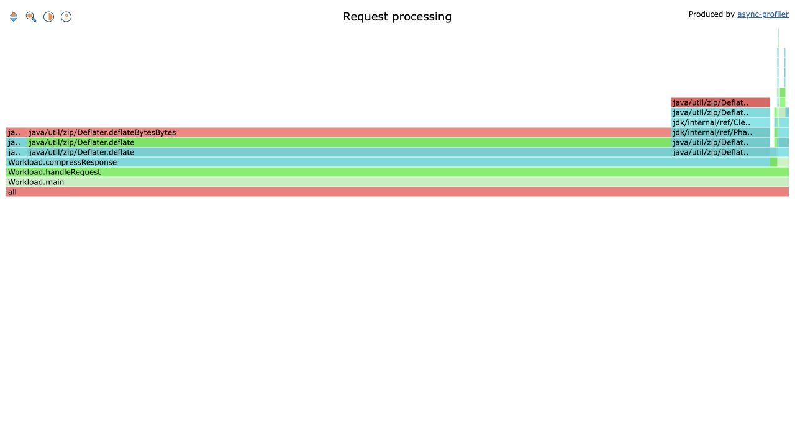

# jfrconv-go

A native Go converter for async-profiler JFR recordings, compatible with
**jfrconv 4.5**. Produces flamegraphs, heatmaps, collapsed stacks, pprof and
OTLP profiles. Supports the official Span API and differential flamegraphs.
The executable runs without a JVM or external dependencies.

## Build

Requires Go 1.23 or newer. Supports Linux and macOS.

```sh
mkdir -p bin
CGO_ENABLED=0 go build -trimpath -ldflags='-s -w' -o bin/jfrconv ./cmd/jfrconv
```

## Usage

```sh
./bin/jfrconv --cpu recording.jfr profile.html
./bin/jfrconv --alloc --total recording.jfr allocations.collapsed
./bin/jfrconv --cpu -o pprof recording.jfr profile.pprof
./bin/jfrconv --cpu -o heatmap recording.jfr heatmap.html
./bin/jfrconv --diff before.collapsed after.collapsed difference.html
```

Open the generated HTML file in a browser. The flamegraph and heatmap use the
original async-profiler 4.5 UI. See the [example flamegraph](examples/flamegraph.html).



The output format follows the filename, or can be selected with `-o`:
`html`, `collapsed`, `pprof`, `pb.gz`, `otlp`, `heatmap`.
Use `-o heatmap` to produce a heatmap ending in `.html`.
Compact async-profiler flamegraph HTML and collapsed stacks can also be
converted to HTML or collapsed output.

With one input and no output path, output is written to the working directory.
For multiple recordings, provide an existing output directory:

```sh
mkdir -p converted
./bin/jfrconv --cpu first.jfr second.jfr converted/
```

For ordinary JDK RUNNABLE execution samples, omit `--cpu` and `--wall`.
These flags select async-profiler's CPU/wall state convention.
Run `./bin/jfrconv --help` for event selectors, filters and layout options.

## Span API

Record spans with async-profiler 4.5:

```java
long span = one.profiler.Span.start();
try {
    handleRequest();
} finally {
    one.profiler.Span.end(span, "GET /api/orders");
}
```

Select samples within matching spans:

```sh
./bin/jfrconv --cpu --tag 'GET /api/orders' --latency 100ms \
  recording.jfr requests.html
```

`--tag` matches a literal string. `--latency` accepts integer `s`, `ms`, `us`
and `ns`; a bare number means milliseconds. Both conditions must match the
same span on the sampled thread. Span intervals include the start and exclude
the end. `--trace` selects `jdk.MethodTrace` events separately.

## Memory limits

```sh
./bin/jfrconv --memory-limit 64M --max-rss 128M --cpu recording.jfr profile.html
```

`--memory-limit` guards major parser/model allocations and sets Go's soft
runtime memory limit. A single conversion runs in the current process; batches
use a worker so a failed batch preserves existing outputs. It is not a hard
RSS cap. `--max-rss` always monitors a separate worker's resident memory every
2 ms; it can overshoot between samples and does
not include the supervisor. Use a Linux cgroup or container limit for a strict
limit on the whole process tree. Sizes use binary units.

Limit denial exits with status **75**, removes temporary files and preserves
existing regular outputs. `--memory-stats` reports heap, retained runtime
memory and RSS after each input; it forces a diagnostic GC, so omit it from
latency measurements.

See [compatibility](COMPATIBILITY.md), [architecture](ARCHITECTURE.md),
[testing](TESTING.md) and [benchmarks](BENCHMARKS.md) for details.

## License

Apache-2.0. See [LICENSE](LICENSE) and [NOTICE](NOTICE).
