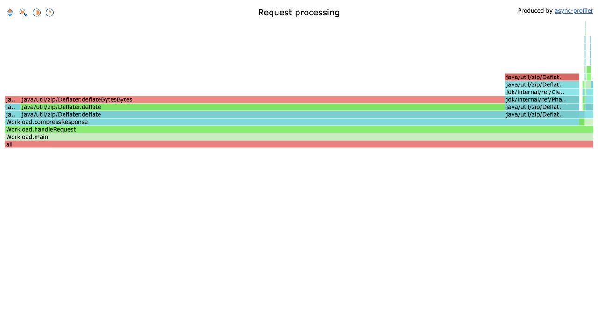

# Flamegraph example

[Open the interactive flamegraph](flamegraph.html). It is a self-contained HTML
file; download it and open it in a browser.



The recording samples a small Java request-processing workload with response
rendering, SHA-256 signing and compression. The screenshot uses the original
async-profiler 4.5 UI.

To record another run, use JDK 17 or newer from the project root:

```sh
make build
javac -d examples examples/Workload.java
java -cp examples Workload examples/example.jfr
bin/jfrconv --title 'Request processing' examples/example.jfr examples/flamegraph.html
```

This example uses JDK execution samples, so it omits `--cpu`. Sample counts and
flamegraph colors vary between runs.
